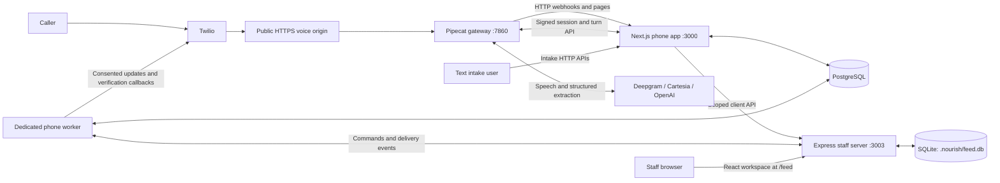

# Project structure and architecture

MealLine combines a pantry staff workspace with a separate phone/text intake application and a Pipecat voice gateway. This guide describes the current codebase, including the older components that are retained but are not part of the default startup.

For installation and credentials, see the [setup guide](setup.md). For a caller-facing walkthrough, see [successful calls and obstacle handling](call-examples-and-obstacle-handling.md).

## Repository structure

The tree below shows the important source directories, not every file or generated artifact.

```text
MealLine/
├── README.md                       # Short introduction and local quick start
├── package.json                    # Staff/core npm workspaces and root commands
├── package-lock.json               # Root dependency lockfile
├── setup.sh                        # Dependency installation and staff setup
├── .env.example                    # Configuration reference, not real credentials
├── .gitignore                      # Excludes dependencies, builds, and private data
├── LICENSE                         # AGPL-3.0-or-later
├── THIRD_PARTY_NOTICES.md           # FEED attribution and provenance
├── docs/                           # MealLine setup, architecture, and call guides
├── scripts/                        # Staff setup/build/run and verification tooling
│   ├── setup.mjs                   # SQLite migrations, reference data, optional import
│   ├── build.mjs                   # Builds core/backend/frontend and packages source
│   ├── run.mjs                     # Starts the built staff server
│   ├── environment.mjs             # Runtime paths, secrets, and environment loading
│   ├── prepare-client-phone.mjs    # Private phone connection preparation/checks
│   └── integration-test.mjs        # Isolated API and backup/restore verification
├── packages/core/                  # Shared TypeScript household business logic
│   ├── src/
│   │   ├── matcher.ts              # Dietary, kitchen, stock, and quantity rules
│   │   ├── clients.ts              # Client profiles and phone command contracts
│   │   ├── types.ts                # Inventory, intake, basket, and delivery types
│   │   └── index.ts                # Shared exports
│   └── test/                       # Matching tests
├── vendor/feed/                    # Retained FEED 1.8.1 source and documentation
│   ├── UPSTREAM.json               # Pinned upstream version/commit
│   ├── docs/                       # Upstream feature and operating guides
│   └── packages/
│       ├── backend/
│       │   ├── src/                # Express server, routes, auth, and services
│       │   ├── prisma/             # Canonical staff schema and SQLite migrations
│       │   └── assets/             # PDF fonts and other backend assets
│       └── frontend/
│           ├── src/                # React staff screens, hooks, and API clients
│           └── public/             # Browser assets, fonts, and branding
├── mealline/                       # Separate Next.js phone/text application
│   ├── package.json                # Its own installation/build/worker commands
│   ├── package-lock.json           # Separate phone-app dependency lockfile
│   ├── app/                        # Text intake, simulator, pages, and API handlers
│   ├── lib/                        # Controller, phone flow, verification, and jobs
│   ├── db/migrations/              # PostgreSQL phone/session/outbox schema
│   ├── scripts/                    # Phone migrations, adapter setup, and workers
│   ├── tests/                      # Controller, phone, webhook, and integration tests
│   └── voice_agent/                # Active phone-app Pipecat adapter
│       ├── server.py               # FastAPI gateway and HTTP/WebSocket routing
│       ├── pipeline.py             # Speech transport, STT, TTS, and turn processing
│       ├── extraction.py           # Structured interpretation of one answer
│       ├── security.py             # Stream tickets and Twilio signature checks
│       ├── run.sh                  # Launches the gateway with a Python environment
│       └── requirements.txt        # Python voice dependencies
├── agent/                          # Separate standalone FEED printable-list adapter
├── db/migrations/                  # Retained original pantry PostgreSQL schema
└── legacy/next/                    # Archived pre-FEED staff application
```

The root npm workspaces are `packages/core`, the FEED backend, and the FEED frontend. The nested `mealline/` application is not a root workspace: it has its own dependencies and startup. Python dependencies are also installed separately.

## Runtime architecture

The local quick start runs only the staff workspace. The diagram shows the additional services used when phone integration is separately configured and enabled.



| Component | Responsibility | Typical local address |
| --- | --- | --- |
| FEED React/Vite frontend | Inventory, clients, intakes, household baskets, deliveries, analytics, reports, and administration | Served by the backend at `http://localhost:3003/feed` |
| FEED Express/Prisma backend | Staff authentication, canonical pantry records, matching, fulfillment transactions, exports, and recovery | `http://127.0.0.1:3003` |
| Next.js phone/text app | Conversation state, confirmation, returning-caller verification, drafts, and communication jobs | `http://127.0.0.1:3000` |
| Python FastAPI/Pipecat gateway | Streaming audio, speech providers, structured extraction, and proxying public phone HTTP requests to Next.js | `http://127.0.0.1:7860` |
| Dedicated phone worker | Durable synchronization, delivery-event polling, consent-aware notifications, and verification callbacks | Background process; no separate HTTP port |

The root launcher and Python gateway bind to loopback. Run the phone application with the private listener described in the [Pipecat guide](../mealline/docs/pipecat.md). The public voice origin routes to the gateway, not the staff developer-login server. The gateway's HTTP proxy refuses to forward internal/demo administration routes; this is not a substitute for a reviewed deployment.

English and Spanish can use Pipecat streaming. Vietnamese uses the retained TwiML path. Streaming failure or a request for a person returns control to the phone application. The text intake page uses the Next.js controller directly; it should not be assumed to offer every verified phone self-service action.

## Data ownership

| Store | Owns | Does not own |
| --- | --- | --- |
| Staff SQLite, default `.nourish/feed.db` | FEED inventory and settings; MealLine households, revisions, call snapshots, follow-ups, intakes, baskets, volunteers, deliveries, replay receipts, and delivery events | Live audio transport or phone job leases |
| Phone PostgreSQL, configured by `MEALLINE_DATABASE_URL` | Conversation sessions/turns, local cases, agent turn receipts, verification challenges, dedicated phone jobs, and event cursor | Authority to approve pantry baskets or deduct pantry stock |

The staff schema is [schema.prisma](../vendor/feed/packages/backend/prisma/schema.prisma). MealLine additions retain the `Nourish*` model prefix for compatibility. Shared food identity and exact quantities belong to FEED's `FoodItem`; household-specific allocations belong to `NourishBasket`, not FEED's printable-list templates.

Phone migrations live in [mealline/db/migrations](../mealline/db/migrations). Legacy phone-demo cases and `outbox_jobs` remain in that application; the dedicated phone worker does not claim those legacy jobs.

The original pantry PostgreSQL import is a separate concern from the active phone database. Root setup can import five legacy pantry tables once into SQLite using `DATABASE_URL`. It leaves the source unchanged and does not establish continuous database replication.

## From a call to a completed delivery

1. **Collect and verify.** The phone controller chooses the workflow, obtains consent, collects household needs, and verifies access before opening private returning-household records. The model proposes answers; it does not decide identity or authorization.
2. **Confirm.** The caller hears a readback and explicitly confirms. An interrupted or unconfirmed draft is not a completed food request.
3. **Synchronize.** Confirmed client-service work is queued with an immutable command ID in PostgreSQL. The dedicated worker submits it to the staff client API. The backend deduplicates commands, preserves version boundaries, and records the household/intake and draft basket. Conflicting edits become staff follow-up rather than silent overwrites.
4. **Review and approve.** Staff inspect the draft against dietary needs, equipment, and inventory. Approval creates the delivery task; it is not a stock reservation or a completed delivery.
5. **Pack and dispatch.** Packing rechecks suitability and stock in a transaction and deducts exact quantities once. A volunteer must be assigned and the basket packed before transit. Cancellations and unresolved safety holds prevent inappropriate dispatch.
6. **Complete and report.** Staff mark delivery completion. Linked intake/basket records and analytics reflect the outcome; delivery events can trigger opted-in updates. Requests, approvals, provider acceptance, and actual completed deliveries remain different measures.

Matching is implemented in [packages/core/src/matcher.ts](../packages/core/src/matcher.ts): availability, dietary flags/name exclusions, kitchen equipment, a default maximum of 20 food items, and household-scaled quantities capped by stock. These are heuristic filters, not allergen certification. Staff must review food labels and household notes.

The Pipecat gateway does not write pantry inventory, approve food, assign volunteers, or promise delivery. Automatic stock deduction is tied to staff packing; staff voice commands for general inventory changes are not an implemented end-to-end feature.

## Integration and trust boundaries

| Boundary | Interface | Credential or guard |
| --- | --- | --- |
| Staff browser to pantry | FEED routes under `/feed/api`, including `/feed/api/nourish` | Staff session and role checks; explicit loopback-only developer shortcut for local work |
| Phone app/worker to pantry client service | `/api/voice-agent/commands` and `/api/voice-agent/events` | Dedicated `NOURISH_AGENT_API_TOKEN`; returning-caller grants and command validation |
| Phone controller and Pipecat gateway | Controller `/api/voice/agent/session` and `/api/voice/agent/turn`; gateway `/internal/interpret` | `MEALLINE_AGENT_KEY`, signed call/session tickets, and validated turn proposals |
| Twilio to voice handlers/streams | `/api/voice/inbound`, turn/status callbacks, and gateway WebSocket stream | Twilio signatures, call binding, and stream validation |
| Older confirmed-intake bridge to pantry | `POST /api/voice-intakes` | Separate ingestion-only `NOURISH_VOICE_API_TOKEN` |

These credentials are not interchangeable. A speech/model provider key does not grant staff access. The controller and backend enforce confirmation, field scope, versions, and fulfillment rules independently of model output.

Durable client-service integration uses the dedicated PostgreSQL phone outbox plus SQLite replay receipts and an event cursor. It is retry-safe for supported commands, not a single transaction spanning both databases. Jobs can remain pending while a service is unavailable. Uncertain external notification sends require review instead of blind retries; contact verification and current consent are checked before updates are sent.

The older bridge in [mealline/lib/nourish.ts](../mealline/lib/nourish.ts) is best-effort and does not provide that durable retry queue. It remains for compatibility and should not be described as equivalent to the client-service path.

## Where to change behavior

| Change | Main implementation |
| --- | --- |
| Household matching and shared contracts | [packages/core/src](../packages/core/src) |
| Staff workspace screens and routing | [FEED frontend App.tsx](../vendor/feed/packages/frontend/src/App.tsx) and [MealLine components](../vendor/feed/packages/frontend/src/components/nourish) |
| Basket approval, packing, and delivery transitions | [services/nourish/index.ts](../vendor/feed/packages/backend/src/services/nourish/index.ts) |
| Canonical profiles, revisions, agent commands, and follow-up | [services/nourish/clients.ts](../vendor/feed/packages/backend/src/services/nourish/clients.ts) and [client-service routes](../vendor/feed/packages/backend/src/routes/nourish-agent.ts) |
| Authored caller workflow and verification | [phoneFlow.ts](../mealline/lib/phoneFlow.ts), [phonePrompts.ts](../mealline/lib/phonePrompts.ts), and [phoneVerification.ts](../mealline/lib/phoneVerification.ts) |
| Phone API connection and durable communication jobs | [nourishPhone.ts](../mealline/lib/nourishPhone.ts), [phoneJobs.ts](../mealline/lib/phoneJobs.ts), and [phone-worker.ts](../mealline/scripts/phone-worker.ts) |
| Streaming speech and field extraction | [mealline/voice_agent](../mealline/voice_agent) and [phone agent adapter](../mealline/lib/agent.ts) |
| Database fields or schema | [staff Prisma schema/migrations](../vendor/feed/packages/backend/prisma) and [phone PostgreSQL migrations](../mealline/db/migrations) |
| Root setup, build, and runtime configuration | [scripts](../scripts) and [root package.json](../package.json) |

`agent/` is a separate standalone adapter that creates FEED printable-list instances through existing FEED APIs with a service-account JWT. It has its own Python matching implementation. It is not the phone app's `voice_agent/` gateway and does not replace the canonical household basket lifecycle. Likewise, `legacy/next/` and the root `db/migrations/` are retained historical code, not the current staff runtime.

## Build, private files, and verification

Root setup prepares the shared core and staff database/backend. Root build compiles the shared package, backend, and Vite frontend, prepares assets, and packages corresponding source. The staff backend serves the built frontend; a separate Vite server is optional during development. Root startup does not launch Next.js, Pipecat, or a phone worker.

Local/generated files are excluded from Git:

- `.nourish/`: staff SQLite database, runtime credentials, uploaded/generated storage, source archives, caches, and verification artifacts.
- `node_modules/`, `.next/`, `.venv/`, and the configured staff/core `dist/` outputs: installed dependencies and build/runtime artifacts.
- Private `.env` files: configuration and provider credentials. `.env.example` templates are intentionally committed.

Back up private runtime data securely; GitHub is not a backup of household records or credentials. Application backups and phone recovery have additional verification/retention rules in the [setup guide](setup.md#data-and-recovery) and [client phone guide](client-phone-interface.md#verification-and-recovery).

Root `npm test` covers shared logic, configuration/branding, authentication, and isolated API/restore behavior. Optional PDF/browser checks exercise exports and the built staff UI. Phone tests live in `mealline/tests`; Python gateway tests live in `mealline/voice_agent/test_agent.py`. None of these automatically proves a successful real-world phone call or paid-provider readiness.

Client self-service is off by default with `NOURISH_CLIENT_PHONE_ENABLED=false` and needs a separately authorized pilot. The inherited frontend type-check debt and remaining provider/deployment checks are documented in [FEED integration and verification limits](feed-integration.md#verification-checkpoint). This architecture is an implementation map, not a production certification.
